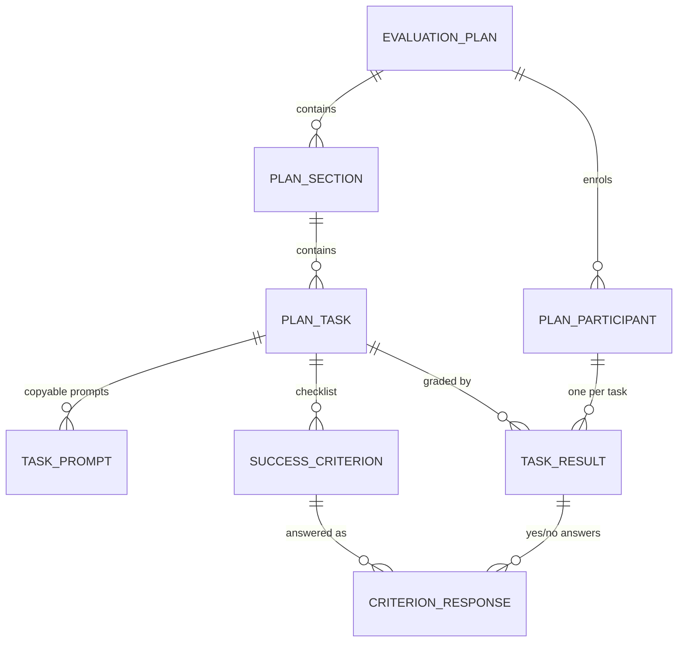

# Hands-On Lab Guide

A ServiceNow scoped application for running facilitated, hands-on lab
evaluations. Facilitators author structured lab plans; participants work
through them task by task, copy prompts into the product being evaluated,
self-assess against success criteria, and submit pass/fail verdicts with
feedback. Facilitators watch progress and results roll up live.

| | |
|---|---|
| **Scope** | `x_snc_holg` |
| **Version** | 1.0.0 |
| **Portal URL** | `/holg` |
| **REST base** | `/api/x_snc_holg/lab` |
| **SDK** | `@servicenow/sdk` 4.14.0 |

## Concept

An **Evaluation Plan** is a lab. It contains ordered **Plan Sections**, each
containing ordered **Plan Tasks**. A task carries the instructional content —
scenario, description, how-to-test notes, dependency warnings — plus two
ordered child lists:

- **Task Prompts** — the text a participant copies into the product under test
- **Success Criteria** — the yes/no checklist defining "did this work?"

When a participant opens a published plan they are enrolled as a **Plan
Participant**, and a **Task Result** row is created for every task in the plan.
As they work, they answer each criterion (**Criterion Response**) and finally
submit a pass/fail verdict with optional feedback. Submitting recalculates
their completion percentage.

## Data model



| Table | Label | Key fields |
|---|---|---|
| `x_snc_holg_evaluation_plan` | Evaluation Plan | `name`, `description`, `status`, `facilitator` |
| `x_snc_holg_plan_section` | Plan Section | `title`, `overview`, `evaluation_plan`, `order` |
| `x_snc_holg_plan_task` | Plan Task | `title`, `description`, `scenario`, `how_to_test`, `dependency_note`, `plan_section`, `order` |
| `x_snc_holg_task_prompt` | Task Prompt | `label`, `prompt_text`, `plan_task`, `order` |
| `x_snc_holg_success_criterion` | Success Criterion | `criterion`, `plan_task`, `order` |
| `x_snc_holg_plan_participant` | Plan Participant | `evaluation_plan`, `user`, `status`, `percent_complete`, `started_on`, `completed_on` |
| `x_snc_holg_task_result` | Task Result | `plan_participant`, `plan_task`, `user`, `status`, `result`, `feedback`, `submitted_on` |
| `x_snc_holg_criterion_response` | Criterion Response | `task_result`, `success_criterion`, `answer` |

### Stored choice values

- Plan `status`: `published` (participants can only read published plans)
- Participant `status`: `in_progress`, `complete`
- Result `status`: `not_started`, `in_progress`, `submitted`
- Result `result`: `pass`, `fail`
- Criterion `answer`: `yes`, `no`

## Roles

| Role | Purpose |
|---|---|
| `x_snc_holg.facilitator` | Authors and manages plans, sections, tasks, prompts, criteria, participants and results |
| `x_snc_holg.participant` | Works through published plans; reads published content and manages only their own participation and results |

Plus the scope defaults `x_snc_holg.admin` and `x_snc_holg.user`.

## Security model

Roughly 45 record ACLs enforce a strict ownership model:

- Participants read Evaluation Plans **only** while `status=published`
  (condition-based ACL).
- Participants read and write **only their own** Task Results and Criterion
  Responses. Ownership on `criterion_response` is resolved by walking up to the
  parent Task Result and comparing `user` against `gs.getUserID()` in an
  advanced scripted ACL.
- Facilitators read across all participants; only facilitators may delete.
- Every table read and write in the REST layer goes through
  **`GlideRecordSecure`**, so the ACLs — not the API — are the single source of
  truth for access.

## Server API

`LabApi` (`x_snc_holg.LabApi`, package-private Script Include) is the logic
behind the **Lab** Scripted REST API at `/api/x_snc_holg/lab`.

| Method | Path | Purpose |
|---|---|---|
| `GET` | `/me` | Current user, effective roles, impersonation state |
| `GET` | `/plans` | Published plans with the caller's participation summary |
| `GET` | `/plans/{plan_id}` | Full plan tree: sections, tasks, prompts, criteria, the caller's own results and answers |
| `POST` | `/plans/{plan_id}/start` | Idempotent enrolment |
| `POST` | `/tasks/{task_id}/result` | Idempotent per-task result materialisation |
| `PATCH` | `/results/{result_id}` | Move a result to `in_progress`, or submit with `pass`/`fail` + feedback |
| `PUT` | `/results/{result_id}/criteria/{criterion_id}` | Upsert one yes/no answer |
| `GET` | `/facilitator/plans/{plan_id}/summary` | Participant roster, per-task status/result counts, pass rate per section, 25 most recent submissions |

### Behaviours worth knowing

- **`{plan_id}` accepts a sys_id *or* a readable slug.** Slugs are derived from
  the plan name: non-alphanumerics become separators, the stop-words
  `a`/`the`/`with`/`and` are dropped (`for` is deliberately kept), and the first
  four words are joined with `-`. `Now Assist for Creator` →
  `Now-Assist-for-Creator`.
- **`GET /plans/{plan_id}` writes records.** For participants it enrols the
  caller and bulk-creates their missing Task Result rows so nobody lands on a
  task with no result row. It is idempotent, narrow (caller's own rows only),
  batched (one `IN` query, never one per task), and any refused write is
  swallowed so a read never fails because a write was denied.
- **A submitted verdict is final** — `PATCH` returns `409` on an
  already-submitted result.
- **The criteria checklist stays editable after submission**, by design:
  participants routinely revisit a finished task. The verdict stays locked.
- **Impersonation is detectable but not attributable from scope.**
  `ScopedGlideSession` exposes `isImpersonating()` but not the impersonating
  user's identity, so the client remembers the original user itself.

## User interface

### Service Portal — `/holg`

| Page | ID | Required role |
|---|---|---|
| Hands-On Lab Guide (landing) | `home` | — (role-based routing) |
| My Lab Plans | `plans` | `x_snc_holg.participant` |
| Lab Plan | `plan` | `x_snc_holg.participant` |
| Facilitator Dashboard | `facilitator` | `x_snc_holg.facilitator` |

Widgets: `x_snc_holg_home_gate` (role-aware access message),
`x_snc_holg_participant_shell`, `x_snc_holg_facilitator_shell`. The two shell
widgets host the React applications.

### BYOUI React apps

Two UI Pages host React single-page apps, also surfaced through the portal
shell widgets:

- `x_snc_holg_participant.do` — plan view, task panel, prompt boxes with
  copy-to-clipboard, success-criteria checklist, feedback panel, progress bar
- `x_snc_holg_facilitator.do` — facilitator dashboard

## Project layout

```
metadata/              Application metadata as update XML
  update/              Tables, ACLs, roles, widgets, pages, REST API, Script Include
  author_elective_update/
src/fluent/generated/
  keys.ts              Generated sys_id registry — do not hand-edit
dist/, target/         Build output
```

### Build

```bash
npm run build      # now-sdk build
npm run deploy     # now-sdk install
npm run transform  # convert metadata XML into Fluent TypeScript
npm run types      # refresh dependency types
```
